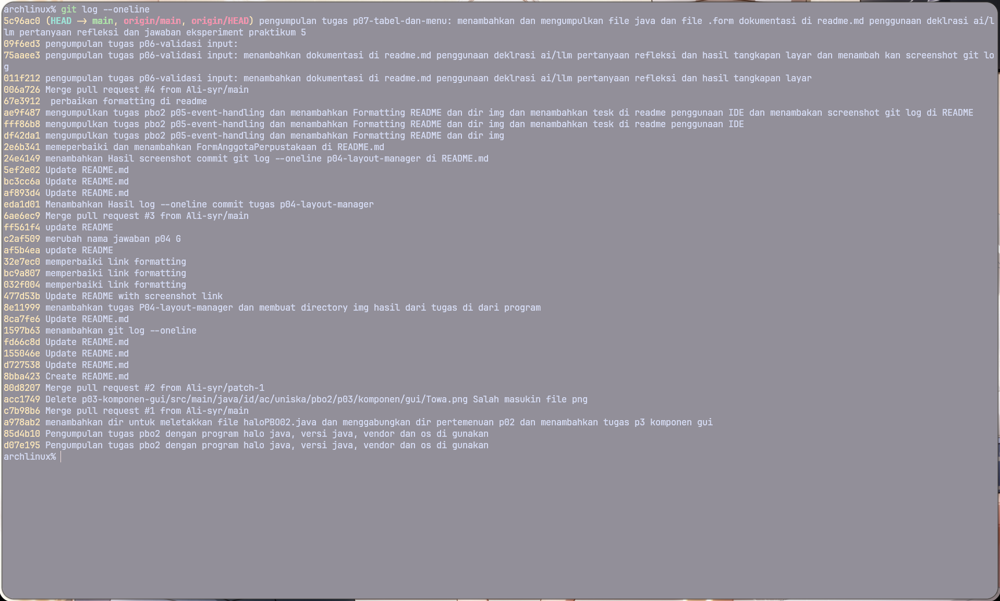

### Tugas Pbo2 p05-event-handling 2410010012
Muhammad Ali Akbar 2410010012 5C

IDE Menggunakan IntelliJ IDEA OSS
###  Log Commit

### Jawaban Eksperimen Praktikum 5

1. Efek menghilangkan fireTableRowsInserted:Baris data baru berhasil ditambahkan ke list, tetapi tabel tidak langsung menggambar ulang/berubah visualnya di layar.
Data baru baru akan muncul setelah jendela di-minimize/resize.

2. Saat mencari kata "ah" dan memilih Ahmad Fauzi (baris tampilan ke-1), dialog konfirmasi justru menampilkan Budi Santoso. Ini terjadi karena indeks baris pada tampilan (view) tidak lagi sama dengan indeks asli pada model setelah disaring/diurutkan.

3. Mengubah modal menjadi false pada Dialog:   Hasil: Jendela utama tetap dapat diklik meskipun dialog masih terbuka. Program langsung mengeksekusi kode di bawah

4. Method perbaruiTombol() memanggil setEnabled(false) pada item menu ubahItem dan hapusItem saat getSelectedRow() < 0. Item menu yang nonaktif secara otomatis mengabaikan masukan pintasan accelerator.

5. hapusItem.setAccelerator(javax.swing.KeyStroke.getKeyStroke(java.awt.event.KeyEvent.VK_DELETE, 0)); (tanpa ada InputEvent.CTRL_DOWN_MASK).

6. Di dalam initComponents(), NetBeans mencoba menjalankan kontakTable.setModel(model). Karena variabel model belum diinstansiasi (masih null), program langsung mengalami crash

### Jawaban Refleksi p07-tabel-dan-menu

1. JTable murni bertindak sebagai komponen antarmuka visual, JTable selalu mengandalkan TableModel untuk menanyakan jumlah baris, kolom, dan isi nilai sel setiap kali proses menggambar ulang

2. Data di memori (list/array) berubah, tetapi JTable tidak tahu bahwa ada perubahan data sehingga tampilan antarmuka tidak diperbarui

3. Menyorot satu karakter dengan garis bawah dan diakses menggunakan tombol Alt + [Huruf] (misal Alt+K untuk menu Kontak) saat navigasi menu.

   Accelator Pintasan keyboard langsung (misal Ctrl+N atau Ctrl+D) yang mengeksekusi fungsi tanpa harus membuka struktur menu terlebih dahulu.

4. Agar dialog mengunci jendela utama sampai pengguna selesai mengisi data atau membatalkannya. Selain itu, membuat eksekusi baris kode setVisible(true)

5. Saat tabel diurutkan berdasarkan kolom Nama A-Z, baris ke-0 pada layar mungkin berisi "Ahmad", padahal di model asli baris ke-0 adalah "Zul".

6. Karena properti Custom Code pada JTable (kontakTable.setModel(model)) disalin oleh IDE ke dalam method initComponents()

### Deklarasi penggunaan ai/llm:

- Praktikum 7: Saya sangat mengalami kendala saat desgin ui di intellij saya minta saran dari ai/llm membantu menyelesaikan masalah saya dan meminta bantuan untuk review function method dan konstruktor yang saya buat

- ai/llm membantu saya memahami materi yang belum saya kuasai dan kasih saran dalam menyelesaikan kendala selama praktikum, dan meningkatkan pemahaman saya dalam menggunakan Java
